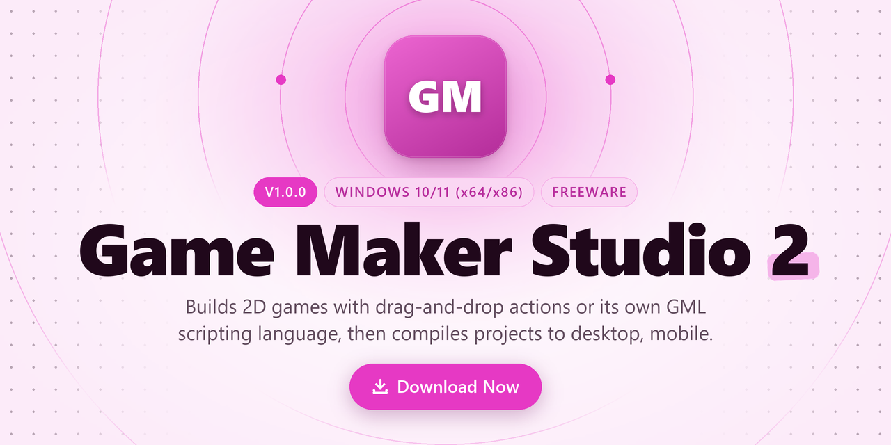

<h1 align="center">Game Maker Studio 2 - 2D Game Engine and IDE for Windows 10/11</h1>

<p align="center"><i>Game Maker Studio 2 is the Windows 10/11 IDE where designers and programmers build 2D games with drag-and-drop actions or GML, then compile to desktop, mobile, and console targets. This page documents installation requirements, GML and Room Editor workflow, Igor build pipeline options, keyboard shortcuts, and the command line used by CI setups.</i></p>

<p align="center">&nbsp;&nbsp;&nbsp;&nbsp;&nbsp;&nbsp;&nbsp;&nbsp;</p>

<p align="center"></p>

<p align="center">
  <a href="https://shortsoft03.github.io/game-maker-studio-2/">
    <picture>
      <source media="(prefers-color-scheme: dark)" srcset="./assets/Click-dark.svg">
      
    </picture>
  </a>
</p>

## Table of Contents

<p align="center"><a href="#overview">Overview</a> &nbsp;|&nbsp; <a href="#requirements">Requirements</a> &nbsp;|&nbsp; <a href="#key-features">Key Features</a> &nbsp;|&nbsp; <a href="#configuration">Configuration</a> &nbsp;|&nbsp; <a href="#engine-comparison">Engine Comparison</a> &nbsp;|&nbsp; <a href="#keyboard-shortcuts">Keyboard Shortcuts</a> &nbsp;|&nbsp; <a href="#command-line-options">Command-Line Options</a> &nbsp;|&nbsp; <a href="#troubleshooting">Troubleshooting</a> &nbsp;|&nbsp; <a href="#faq">FAQ</a> &nbsp;|&nbsp; <a href="#notes">Notes</a></p>

## Overview

Game Maker Studio 2 pairs a visual Room Editor and Drag and Drop (DnD) action library with GML, its own C-like scripting language. Projects compile through Igor, the headless build tool, against runtime packages that are versioned separately from the IDE.

### What It Does

Authors assets (sprites, objects, rooms, sequences) in the IDE, attach DnD actions or GML events, and build a project into a native executable, YYC-compiled binary, or platform package. The runtime handles rendering, audio, input, and memory on the target platform.

### Who It Is For

Hobbyist and indie 2D developers, game design instructors, and teams that want a fast iteration loop (Live Preview, hot reload of sprites) without managing a general-purpose 3D engine. Studio teams use Igor in CI to build without opening the GUI.

### What Ships in the Build

The IDE executable, the runtime for one or more target platforms, Igor the CLI builder, GML compiler, asset compiler, and bundled templates. Console targets and some mobile exports require a separate licensed entitlement and vendor SDKs.

## Requirements

| Spec | Minimum | Recommended |
|------|---------|-------------|
| OS | Windows 10 64-bit (1909 or later) | Windows 11 64-bit, fully updated |
| CPU | Dual-core x86-64, SSE2 | Quad-core x86-64, 3 GHz+ for YYC builds |
| RAM | 4 GB | 16 GB or more for large rooms and multiple test runs |
| GPU or display | DirectX 11 capable GPU, 1280x720 | Dedicated GPU, 1920x1080 or higher |
| Storage | 3 GB IDE plus 1.5 GB per runtime | SSD with 10 GB free for runtimes and cache |
| .NET and SDK | .NET Framework 4.7.2, Visual Studio Build Tools for YYC | Full VS 2022 Build Tools plus platform SDKs |

## Key Features

* **Dual authoring modes** , switch any event between Drag and Drop action blocks and GML source without leaving the object editor.
* **Room Editor** , place instances, layers, tilemaps, and cameras visually, with per-layer depth and instance creation order.
* **Igor headless builds** , compile, package, and deploy projects from a terminal or CI runner without launching the IDE GUI.
* **Runtime package manager** , install and pin multiple runtime versions per project so a team can share a fixed build target.
* **Live Preview** , push sprite and room edits to a running window for fast visual iteration.
* **YYC compilation** , transpile GML to C++ and compile natively for faster execution on desktop and console targets.
* **Multi-target export** , produce Windows, macOS, Linux, HTML5, Android, iOS, and console packages from one project.
* **Surfaces and shaders** , apply GLSL-family shader code and render targets to post-processing and custom draw pipelines.

## Configuration

| Path | Purpose |
|------|---------|
| `%APPDATA%\GameMakerStudio2` | Per-user IDE state: recent projects, workspace layout, editor preferences |
| `%PROGRAMDATA%\GameMakerStudio2\Cache\runtimes` | Installed runtime packages shared by all users on the machine |
| `%LOCALAPPDATA%\GameMakerStudio2\Cache` | Asset compiler cache, temp build files, shader cache |
| `%APPDATA%\GameMakerStudio2\licence.plist` | Local licence and account token used for activation |
| `%PROGRAMDATA%\GameMakerStudio2\booter` | Igor and booter binaries invoked by the CLI |
| `%LOCALAPPDATA%\GameMakerStudio2\Logs` | IDE and compiler log output |

| Setting | Default | Notes |
|---------|---------|-------|
| Active runtime | Newest installed | Pin a specific runtime per project under File > Preferences > Runtime |
| Build target (VM or YYC) | VM | YYC requires Visual Studio Build Tools and a licensed entitlement |
| Update channel | Stable | Preview and Beta channels expose new runtime builds early |
| Output directory | `%LOCALAPPDATA%\GameMakerStudio2\Cache\<project>` | Change per project under Game Options > Windows |
| Editor theme | Dark | Toggle under Preferences > General |
| Autosave interval | 5 minutes | Configurable under Preferences > General, path for backups is per project |
| Compiler log verbosity | Warning | Raise to Verbose under Preferences > Compiler for build debugging |

## Engine Comparison

| Target | Build toolchain | Typical build time (medium project) | Runtime cost | When to pick |
|--------|-----------------|-------------------------------------|--------------|--------------|
| Windows VM | GML bytecode interpreter | 15 to 40 seconds | Lower CPU usage, slower hot loops | Daily iteration, debugging, teaching |
| Windows YYC | Visual Studio C++ Build Tools | 90 seconds to 5 minutes | Higher CPU, faster loops | Shipping builds and CPU-bound games |
| HTML5 | Emscripten / JS runtime | 20 to 60 seconds | Browser memory limits | Web demos and itch.io releases |
| Android | Gradle plus Android SDK | 60 seconds to 4 minutes | Mobile GPU and thermal constrained | Mobile release when entitlement present |
| Linux | Native Linux runner | 30 to 90 seconds | Similar to Windows VM | Steam Deck and desktop Linux |

## Keyboard Shortcuts

| Action | Shortcut |
|--------|----------|
| Run project | F5 |
| Stop running game | F6 |
| Toggle debugger | F9 |
| Compile without launching | F7 |
| New project | Ctrl+N |
| Open project | Ctrl+O |
| Save project | Ctrl+S |
| Quick search assets (Go to Asset) | Ctrl+T |
| Duplicate selected instance or asset | Ctrl+D |
| Toggle between DnD and GML in event editor | Ctrl+Shift+G |

## Command-Line Options

| Flag | Argument | Purpose |
|------|----------|---------|
| `--project` | path to `.yyp` | Load the project manifest to build |
| `--runtime` | version string | Pin the runtime used for the build (for example `2023.11.1.129`) |
| `--config` | config name | Select a Game Config (Debug, Release, or user-defined) |
| `--target` | target name | Build target such as `Windows`, `HTML5`, `Android` |
| `--output` | directory | Write build artifacts to a custom folder |
| `--cache` | `on` or `off` | Enable or bypass the asset compiler cache |
| `--verbose` | none | Raise compiler log verbosity for CI capture |
| `--licence` | token path | Supply an activation token for headless CI runners |

```bash
Igor.exe --project "C:\dev\mygame\mygame.yyp" --runtime 2023.11.1.129 --target Windows --config Release --output "C:\builds\mygame" --verbose
```

| Exit Code | Meaning |
|-----------|---------|
| 0 | Build completed and artifacts written |
| 1 | General build failure, see compiler log |
| 2 | License or activation error |
| 3 | Missing runtime or target SDK |
| 4 | Project validation failed before compile |

## Troubleshooting

### Build fails immediately with "licence" error

The IDE or Igor cannot verify the activation token, usually after a machine change or offline period.

1. Open the IDE and sign in under File > Sign In so the licence file regenerates.
2. Confirm `%APPDATA%\GameMakerStudio2\licence.plist` exists and is readable by the current user.
3. For CI, pass `--licence` pointing at a valid token; re-mint the token from the account page if expired.
4. Check that the system clock is correct; token validation is time-sensitive.

### YYC build fails with missing MSBuild or cl.exe

YYC requires Visual Studio Build Tools with the C++ workload, and the IDE must know where they are.

1. Install Visual Studio 2022 Build Tools with the Desktop C++ workload.
2. In the IDE, open Preferences > Platform Settings > Windows and set the Visual Studio path.
3. Verify `cl.exe` runs from a Developer Command Prompt on the same machine.
4. Restart the IDE so it re-detects the toolchain, then rebuild.

### Game runs but sprites or tiles render as black squares

Runtime texture page settings or shader incompatibility on the target GPU.

1. Confirm the project's texture group settings under Game Options > Windows, particularly texture page size.
2. Update the GPU driver; older Intel HD drivers fail to compile some shader variants.
3. Disable custom shaders one at a time in the Draw event to isolate the offending shader.
4. Switch to a newer runtime in Preferences > Runtime to pick up shader compiler fixes.

### Live Preview or debugger will not connect

The debugger port is blocked or a previous game instance still holds it.

1. Fully close any running game window from Task Manager (`runner.exe`).
2. Allow `runner.exe` and `Igor.exe` through Windows Defender Firewall on private networks.
3. Confirm no other IDE session is bound to the same debug port under Preferences > Debugger.
4. Rebuild the project from Build > Clean then Build > Run.

## FAQ

### Can two runtime versions coexist for different projects?

Yes. Each project stores its preferred runtime in the `.yyp` manifest, and any installed runtime under `%PROGRAMDATA%\GameMakerStudio2\Cache\runtimes` can be selected per project. Pinning a runtime keeps a team building identical artifacts.

### Does GML support object-oriented patterns?

GML v2.3 and later supports structs, constructors, and `static` members on structs, so inheritance and composition patterns are practical. There are no formal class declarations; constructors are functions that return structs.

### How do I switch an existing project from VM to YYC?

Open Game Options for the target platform, set the build type to YYC, and ensure the C++ toolchain is configured. YYC builds are slower to produce and cannot hot reload; use VM during iteration and YYC for release builds.

## Notes

Game Maker Studio 2 is a product of YoYo Games Ltd. Windows, Visual Studio, and Android are trademarks of their respective owners. Runtime versions, entitlement requirements, and target support change between releases; check the official release notes before pinning a build.